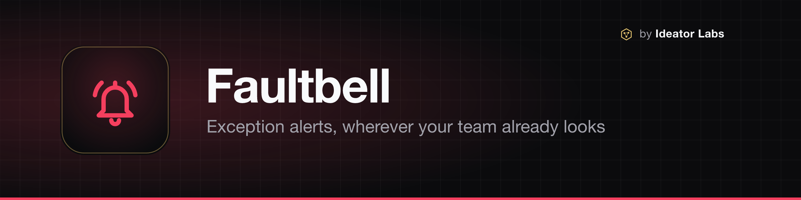

<p align="center"><a href="https://ideatorlabs.github.io/faultbell/"></a></p>
<h1 align="center">Faultbell</h1>
<p align="center"><b>Drop-in exception alerting for Python services and cron jobs: one readable, scrubbed alert per problem, sent to Discord, Slack, Teams, Google Chat, Telegram, PagerDuty, email or any webhook.</b><br><sub>An open-source package by <a href="https://github.com/ideatorlabs">Ideator Labs</a></sub></p>
<p align="center">
  <a href="https://github.com/ideatorlabs/faultbell/actions/workflows/ci.yml"></a>
<a href="https://ideatorlabs.github.io/faultbell/"></a>
  <a href="LICENSE"></a>
  
</p>
<p align="center"><b><a href="https://ideatorlabs.github.io/faultbell/">Documentation</a></b> · <a href="https://ideatorlabs.github.io/faultbell/#60-second-quickstart">Quickstart</a> · <a href="https://ideatorlabs.github.io/faultbell/reference/">API reference</a> · <a href="CHANGELOG.md">Changelog</a></p>

## Why it exists

Small teams rarely run a full error-tracking stack, so production exceptions end up in logs nobody checks.
Faultbell sends each problem to the channels you already watch (Discord, Slack, Microsoft Teams, Google
Chat, Telegram, PagerDuty, email, any JSON webhook or your own function) as one tidy alert with the
traceback, without leaking secrets, flooding the channel or slowing your requests down.

## Features

- **One call to wire in**: `install(app, service=...)` adds a logging handler, `sys` / `threading` / `asyncio`
  hooks and, for FastAPI/Starlette, a request-id middleware plus a catch-all 500 handler. Idempotent.
- **Never in the request path**: capture only snapshots the exception (no frames, no locals) onto a bounded
  queue; one daemon thread sends. Full queue, webhook error or timeout: the alert is dropped and counted.
  Faultbell never raises into your code.
- **No noise**: client errors (anything with an int `status_code` / `status` below 500) never alert. Repeats
  of the same problem are sent at most once per window (default 10 minutes); the next card says how many
  were seen.
- **Job runs**: `job_run()` folds every item failure in a cron run into **one** summary card
  ("Job nightly-sync: 3 of 41 tenants failed"). Nested runs fold into the outer one; demo/test tenants never
  alert.
- **Scrubbed everywhere** (title, message, fields, traceback): emails, Bearer tokens, JWTs, API keys by prefix
  (configurable), `key=` / `token=` / `password=` values, long hex/base64 strings, webhook URLs, URL
  credentials, phone numbers (last four digits kept). Customers appear only as short references.
- **Context that follows the request**: `set_context()` / `context()` backed by a `ContextVar`, shared
  correctly with sync dependencies that run in a thread pool.
- **Every channel you use**: Discord, Slack, Microsoft Teams, Google Chat, Telegram, PagerDuty, email (any
  SMTP server), any JSON webhook, or a function of your own for SMS, tickets or a queue. Set one environment
  variable per channel, or list them in code.
- **Several channels at once**: one alert goes to all of them; a failing channel never blocks the others.
  Each channel can take only some alerts (e.g. PagerDuty and email for crashes, Slack for everything).
- **Check your setup in one command**: `python -m faultbell test` sends a test alert to every channel.
- **Server watch** (`faultbell.watch`): alerts for what an exception hook never sees: a burst of 5xx (or
  many 4xx) on one route, memory above 80% of the container limit, and a process that died without a
  clean shutdown (heartbeat), reported with its peak memory.
- **Zero dependencies** in the core (standard library only). FastAPI and SQLAlchemy support are optional extras.

## Install

```bash
pip install faultbell            # core, standard library only
pip install "faultbell[fastapi]" # with FastAPI
```

> Until the first PyPI release, install straight from GitHub:
> `pip install "faultbell @ git+https://github.com/ideatorlabs/faultbell"`


## 60-second quickstart

Create a webhook in Discord (channel settings, Integrations, Webhooks) and export it:

```bash
export FAULTBELL_WEBHOOK_URL="<your Discord webhook URL>"
export FAULTBELL_ENV=production          # or FAULTBELL_SEND_LOCAL=1 to try it from your laptop
```

```python
import faultbell

faultbell.install(service="billing-worker")  # no webhook configured = everything is a no-op

try:
    1 / 0
except ZeroDivisionError as exc:
    faultbell.capture(exc)  # logger.exception(...) works too once install() has run

with faultbell.job_run("nightly-invoices", total=3, noun="invoices") as run:
    for invoice_id in ("inv-1", "inv-2", "inv-3"):
        try:
            if invoice_id == "inv-2":
                raise TimeoutError("payment gateway timed out")
        except Exception as exc:
            run.fail(exc, item=invoice_id)

faultbell.flush()  # short scripts: wait for the cards to go out before exiting
```

That sends two cards: "Handled ZeroDivisionError in billing-worker" and
"Job nightly-invoices: 1 of 3 invoices failed".

With FastAPI:

```python
from fastapi import FastAPI

import faultbell

app = FastAPI()
faultbell.install(app, service="orders-api")


@app.get("/orders/{order_id}")
def get_order(order_id: int) -> dict[str, float]:
    faultbell.set_context(tenant="Demo Café", tenant_id="t-1001", customer="cus_0001")
    return {"total": 100 / order_id}  # /orders/0 -> "Unhandled ZeroDivisionError in GET /orders/{order_id}"
```

Every response carries an `X-Request-Id` header; the same id is on the card, so a user's report can be
matched to the alert.

## Channels

Set the variables for the channels you want; every alert goes to all of them.

| Channel | In code | Environment variables | What arrives |
| --- | --- | --- | --- |
| Discord | `DiscordTransport(url)` | `FAULTBELL_DISCORD_URL` (or the main `FAULTBELL_WEBHOOK_URL`) | An embed with the traceback attached as a file |
| Slack | `SlackTransport(url)` | `FAULTBELL_SLACK_URL` (an incoming webhook) | A Block Kit message with a colour bar and the end of the traceback |
| Microsoft Teams | `TeamsTransport(url)` | `FAULTBELL_TEAMS_URL` (a Workflows or incoming webhook) | One Adaptive Card |
| Google Chat | `GoogleChatTransport(url)` | `FAULTBELL_GOOGLE_CHAT_URL` (a space webhook) | A formatted text message |
| Telegram | `TelegramTransport(bot_token, chat_id)` | `FAULTBELL_TELEGRAM_BOT_TOKEN`, `FAULTBELL_TELEGRAM_CHAT_ID`, optional `FAULTBELL_TELEGRAM_THREAD_ID` | A bot message with the traceback as a file |
| PagerDuty | `PagerDutyTransport(routing_key)` | `FAULTBELL_PAGERDUTY_ROUTING_KEY` | An Events API v2 trigger; repeats share one incident. Crashes and job summaries only, by default |
| Email | `EmailTransport(to, host=..., port=..., username=..., password=...)` | `FAULTBELL_EMAIL_TO`, `FAULTBELL_SMTP_HOST`, `FAULTBELL_SMTP_PORT`, `FAULTBELL_SMTP_USER`, `FAULTBELL_SMTP_PASSWORD`, optional `FAULTBELL_EMAIL_FROM`, `FAULTBELL_SMTP_SECURITY`, `FAULTBELL_EMAIL_SUBJECT_PREFIX` | A text and HTML email with the traceback attached |
| Any JSON endpoint | `JsonWebhookTransport(url)` | `FAULTBELL_JSON_URL` | `Card.as_dict()` plus a `text` line (Zapier, Make, n8n, your own API) |
| Anything else | `CallbackTransport(fn)` | none | Your function gets the `Card`: SMS, a ticket, a queue message |

- **Which alerts a channel gets**: `kinds=` in code, or `FAULTBELL_<CHANNEL>_KINDS` (e.g.
  `FAULTBELL_EMAIL_KINDS=unhandled,job`). The kinds are `unhandled` (a crash nobody caught), `handled`
  (`capture()` or `logger.exception`) and `job` (a job-run summary).
- **Email security**: `FAULTBELL_SMTP_SECURITY` is `auto` by default: port 465 uses TLS, 587 uses STARTTLS,
  anything else plain SMTP (for a local relay). Set `starttls`, `ssl` or `none` to force one.
- **Chat webhooks can't upload files**, so Slack, Teams and Google Chat show the last 1,500 characters of the
  traceback. Discord, Telegram and email carry the full one.

The same in code (values passed here replace the channel variables; the main webhook is always kept):

```python
import os

import faultbell
from faultbell import CallbackTransport, EmailTransport, PagerDutyTransport, SlackTransport, TelegramTransport

faultbell.configure(
    channels=[
        SlackTransport(os.environ.get("SLACK_WEBHOOK_URL")),
        TelegramTransport(os.environ.get("TELEGRAM_BOT_TOKEN", ""), os.environ.get("TELEGRAM_CHAT_ID", "")),
        EmailTransport(
            "oncall@example.com",
            host="smtp.example.com",
            port=587,  # STARTTLS
            username=os.environ.get("SMTP_USER"),
            password=os.environ.get("SMTP_PASSWORD"),
            kinds=["unhandled", "job"],  # no email for handled exceptions
        ),
        PagerDutyTransport(os.environ.get("PAGERDUTY_ROUTING_KEY", "")),  # crashes and jobs only
        CallbackTransport(lambda card: print("ALERT", card.title), name="stdout"),
    ]
)
print([transport.name for transport, _ in faultbell.active_channels()])
```

A channel with missing settings (an empty URL or token) is skipped. Check what is configured, then send a
test alert to every channel:

```bash
python -m faultbell channels
python -m faultbell test
```

How delivery works: repeats are de-duplicated once, before the alert is sent anywhere. Channels are sent one
after another on Faultbell's own thread; one that fails or times out is counted in `stats()` and the rest
still get the alert. The `local` environment stays quiet on every channel unless `FAULTBELL_SEND_LOCAL=1`.

## Concepts

```
 your code                       Faultbell                                   webhook
 ─────────                       ────────                                   ───────
 install() hooks ─┐
 logger.exception ├─> capture ─> client error? already seen? ──> snapshot ─> bounded queue
 capture(exc)     │              no webhook? -> stop               (no frames, no locals)   │
 job_run().fail ──┘              inside job_run? -> fold into run                           v
                                                                         sender thread (daemon)
                                                                fingerprint -> de-dupe window
                                                                build Card -> scrub -> rate limit
                                                                each channel ──> Discord / Slack / Teams /
                                                                                 Chat / Telegram / PagerDuty /
                                                                                 email / webhook / your fn
```

- **Card**: a transport-neutral description of one alert (title, message, fields, traceback attachment).
- **Fingerprint**: exception type + deepest frame in *your* code + message with numbers and ids removed.
  Same fingerprint inside the window: suppressed and counted.
- **Your code vs library code**: frames under the app root (default: the working directory) that are not in
  `site-packages`, the standard library or Faultbell itself. The card shows the source around the deepest one.
- **Environment**: `production`, `staging`, `local` (or any name). Non-production titles are prefixed, e.g.
  `[STAGING]`. `local` never sends unless `FAULTBELL_SEND_LOCAL=1`, because a developer's `.env` often holds
  the production webhook.

## Server watch

Some failures never raise in your code: an endpoint that keeps answering 503, a process creeping toward its
memory limit, or a container killed for using too much memory. `faultbell.watch` turns those into normal
Faultbell cards.

```python
from fastapi import FastAPI, HTTPException

import faultbell
from faultbell.watch import Watch, WatchMiddleware

app = FastAPI(title="stock-api")
faultbell.install(app, service="stock-api")
watch = Watch(memory_limit_mb=512)  # or FAULTBELL_MEMORY_LIMIT_MB, or the cgroup limit
app.add_middleware(WatchMiddleware, watch=watch)  # counts responses per route template


@app.get("/stock/{item_id}")
def stock(item_id: int) -> dict[str, int]:
    raise HTTPException(status_code=503)  # three of these in 5 minutes -> one card
```

Call `watch.start()` at startup to run memory checks and the heartbeat on a daemon thread. For crash
detection across restarts, give it a shared store: `Watch(store=SQLHeartbeatStore(engine))`
(`pip install "faultbell[sqlalchemy]"`). It creates one small table, `faultbell_heartbeats`.

| Check | Default | Change with |
|---|---|---|
| 5xx burst on one route | 3 in 5 minutes | `burst_5xx`, `window` |
| 4xx burst on one route | 30 in 5 minutes | `burst_4xx`, `window` |
| Memory | 80% of the limit | `memory_limit_mb`, `memory_alert_percent` |
| Crash | no heartbeat for 150 s and no clean stop | `beat_every`, `dead_after`, `store` |
| Repeat cards | one per check and route per 10 minutes | `quiet` |

Health-check paths (`/health`, `/ready`, …) are never counted (`ignore_paths`).

## Configuration

Environment variables (read on every alert, so runtime changes apply immediately):

| Variable | Default | Meaning |
| --- | --- | --- |
| `FAULTBELL_WEBHOOK_URL` | unset | The main webhook. With it and every channel variable unset, Faultbell is a total no-op and starts no thread. |
| `FAULTBELL_WEBHOOK_URL_<ENV>` | unset | Per-environment override, e.g. `FAULTBELL_WEBHOOK_URL_STAGING`. |
| `FAULTBELL_ENV` | detectors, else `local` | `production`, `staging`, `local` (aliases: `prod`, `live`, `stage`, `dev`, `development`). |
| `FAULTBELL_SEND_LOCAL` | `0` | `1` allows sending from the `local` environment. |
| `FAULTBELL_SERVICE` | `install()`'s name | Service name on every card (beats the name given in code). |
| `FAULTBELL_TRANSPORT` | `discord` | How the main webhook is posted: `discord`, `slack`, `teams`, `google_chat` or `json`. |
| `FAULTBELL_<CHANNEL>_*` | unset | One set per channel; see [Channels](#channels). |
| `FAULTBELL_RELEASE` | `GIT_SHA`, `SOURCE_VERSION` | Release / commit shown on the card. |
| `FAULTBELL_DEDUPE_WINDOW` | `600` | Seconds between two cards for the same problem. |
| `FAULTBELL_APP_ROOT` | working directory | Folder that holds *your* code. |
| `FAULTBELL_HOST` | hostname | Host shown on the card. |
| `FAULTBELL_REF_KEY` | built-in | Key for the short customer reference hash; set it to make references unguessable. |
| `FAULTBELL_ICON_URL` | unset | Optional icon for the Discord card's author and footer. |

In code, `faultbell.configure(...)` accepts the same and more; values passed there win over the environment:

```python
import os

import faultbell

faultbell.configure(
    env_detectors=[lambda: os.environ.get("MY_PLATFORM_STAGE")],  # used when FAULTBELL_ENV is unset
    webhook_urls={"staging": os.environ.get("STAGING_ALERTS_URL", "")},
    dedupe_window=300,
    key_prefixes=(*faultbell.DEFAULT_KEY_PREFIXES, "acme_live_"),
    queue_size=200,
    timeout=5.0,
    rate_limit=(5, 2.0),  # Discord allows about 5 posts per 2 seconds per webhook
)
```

Other options: `webhook_url`, `channels`, `env`, `service`, `send_local`, `transport`, `app_root`, `release`,
`request_id_headers`, `clock` (inject a fake clock in tests).

### Public API

| Call | What it does |
| --- | --- |
| `install(app=None, *, service)` | Logging handler, `sys` / thread / asyncio hooks; for an ASGI app the middleware and 500 handler. Idempotent. |
| `set_context(*, service, tenant, tenant_id, customer, phone, feature, **extra)` | Merge fields into the current request's or task's context. `None` keeps a value. |
| `context(**same)` | A block with its own context, restored on exit. |
| `request_id()` | The current request's id, or `None`. |
| `capture(exc, *, handled=True, job=None)` | Report an exception. Returns at once. |
| `job_run(job, *, total=None, noun="items", demo_ids=())` | One summary card for a whole run; yields an object with `fail(exc, *, tenant, tenant_id, item, demo, step)`. |
| `job_failed(exc=None, *, job, tenant, tenant_id, item, demo, **extra)` | An item failure from code without the run object. |
| `flush(timeout=2.0)` | Wait for queued alerts; `True` when drained. |
| `stats()` | Counters: `queued`, `sent`, `suppressed`, `dropped`, `failed` (sent and failed count each channel). |
| `active_channels()`, `enabled()` | The channels the next alert would go to, and whether there are any. |
| `scrub(text)`, `mask_phone(raw)`, `customer_ref(raw)` | The scrubbing helpers, usable on their own. |
| `configure(**settings)`, `reset()`, `uninstall()` | Settings; `reset` / `uninstall` are mostly for tests. |

## Extending: add a channel

For something not covered, `CallbackTransport(fn)` is often enough. For a new HTTP service, subclass
`Transport` and implement `encode()`, or override `send()` for full control. A push-notification channel for
[ntfy](https://ntfy.sh):

```python
import faultbell
from faultbell import Card, Delivery, Transport
from faultbell.transports import http_post


class NtfyTransport(Transport):
    name = "ntfy"

    def send(self, card: Card, url: str, timeout: float) -> Delivery:
        headers = {
            **self.headers,
            "Title": card.title.encode("ascii", "replace").decode(),  # HTTP headers are ASCII
            "Priority": "high" if card.kind == "unhandled" else "default",
        }
        return http_post(
            url, card.message.encode(), "text/plain; charset=utf-8", timeout=timeout, headers=headers
        )


faultbell.configure(channels=[NtfyTransport("https://ntfy.sh/your-alerts-topic", kinds=["unhandled"])])
```

A channel decides `ready()` (configured enough to send) and `destination()` (passed to `send()` as `url`);
the defaults use the URL given to the constructor.

## Running the examples

```bash
uv venv .venv && uv pip install -p .venv -e ".[dev]"
.venv/bin/python examples/local_webhook.py &              # prints every card it receives
export FAULTBELL_WEBHOOK_URL=http://127.0.0.1:8765/ FAULTBELL_SEND_LOCAL=1
python -m faultbell test                                  # one test alert to every channel
.venv/bin/python examples/cron_job.py                     # one summary card for 5 tenants
# server watch: uvicorn examples.server_watch:app, then 3x curl http://127.0.0.1:8000/stock/7
uv pip install -p .venv uvicorn
.venv/bin/uvicorn examples.fastapi_app:app                # then: curl -i http://127.0.0.1:8000/orders/0
```

## Testing

```bash
uv venv .venv && uv pip install -p .venv -e ".[dev]"
.venv/bin/pytest --cov
.venv/bin/ruff check . && .venv/bin/ruff format --check . && .venv/bin/mypy
```

The suite never touches a real webhook: a `http.server` running in the test process plays the webhook, and
the README's Python blocks and the examples are executed against it.

## Limitations and non-goals

- Not a replacement for a full error tracker: no UI, no search, no issue history, no performance tracing.
- De-duplication state lives in each process; several workers can each send the first card of a problem.
- Delivery is best effort by design. A dropped alert is counted in `stats()`, never retried later.
- Chat webhooks (Slack, Teams, Google Chat) can't take file uploads, so they show only the end of the
  traceback. Each channel's message stays inside that service's documented size limits.
- Channels are sent one after another on one thread, so a slow channel (an SMTP server near its timeout)
  delays the ones after it by up to `timeout` seconds.
- Scrubbing is pattern based. It catches common shapes of secrets and personal data, not every possible one.
  Keep secrets out of exception messages where you can.

## Roadmap

- More channels on request (Opsgenie, SMS through a provider).
- Optional shared de-duplication through Redis.

## Contributing

See [CONTRIBUTING.md](CONTRIBUTING.md). Bug reports and small, focused pull requests are welcome.

## License

Apache-2.0. See [LICENSE](LICENSE) and [NOTICE](NOTICE).
